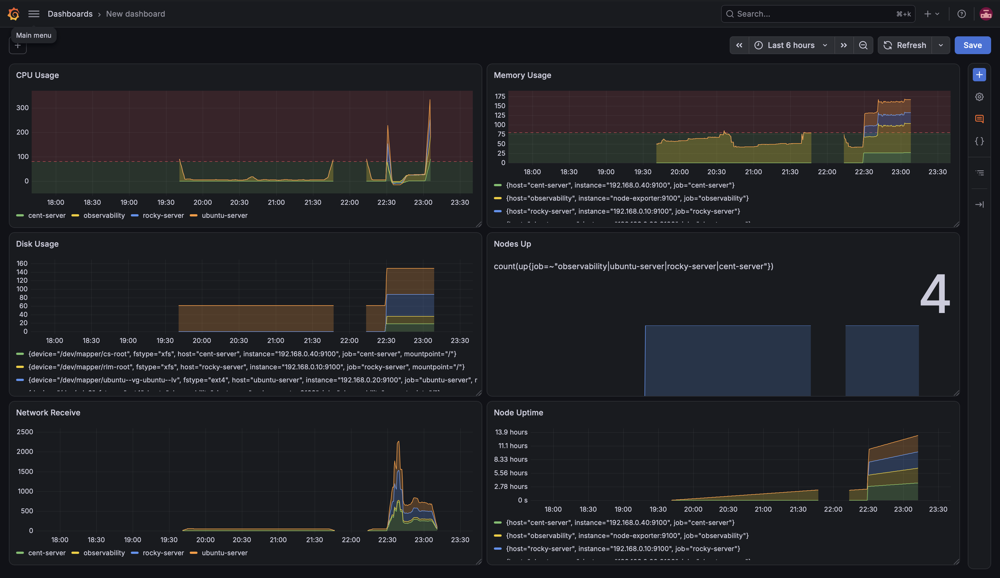
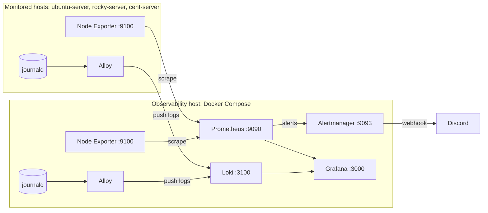
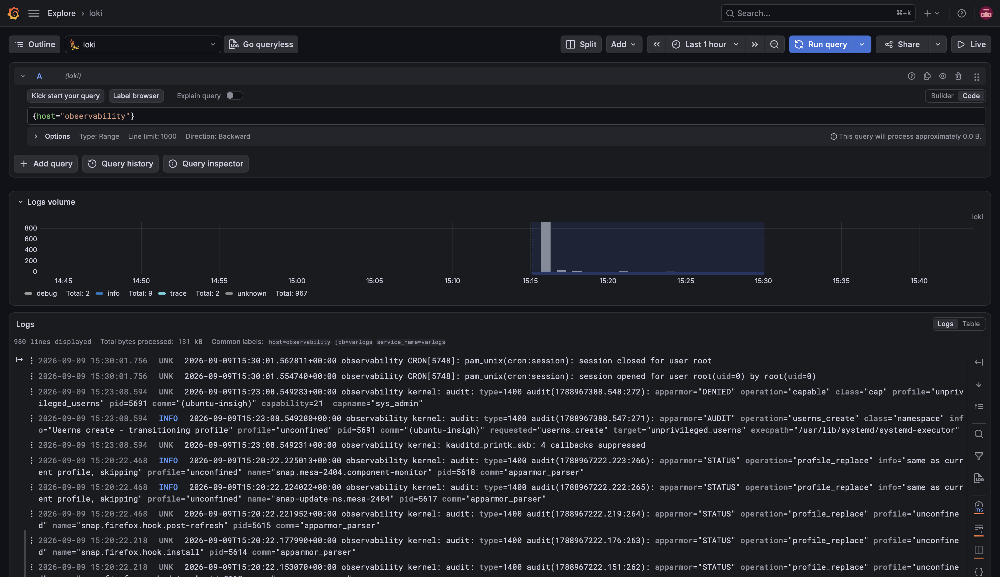
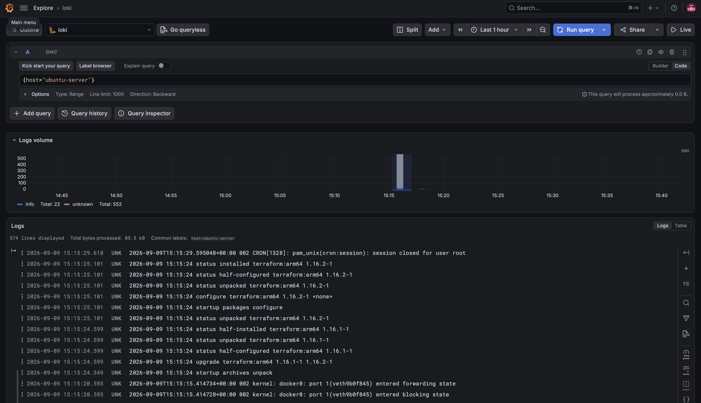
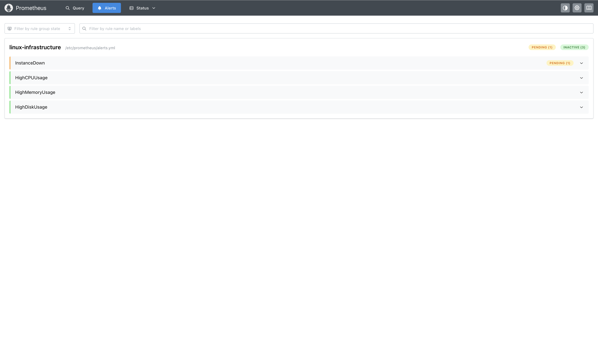
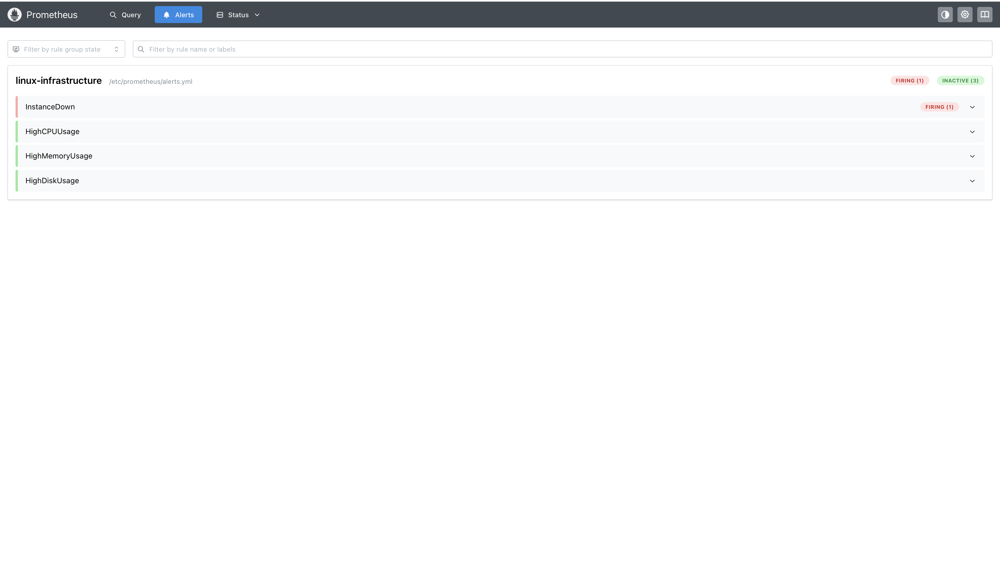
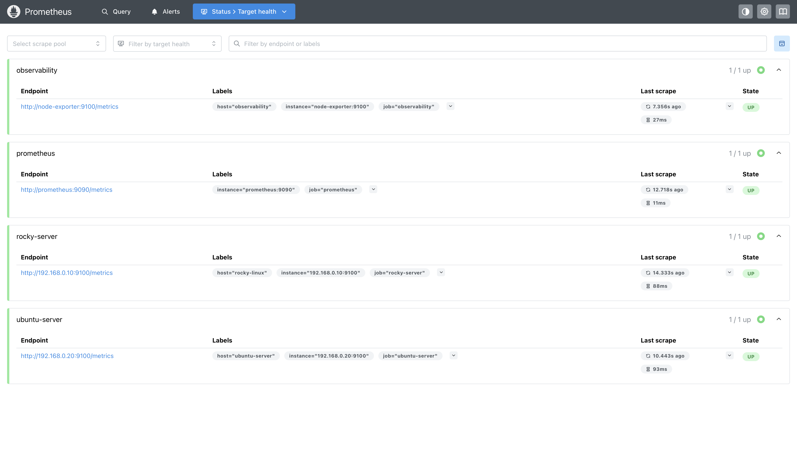
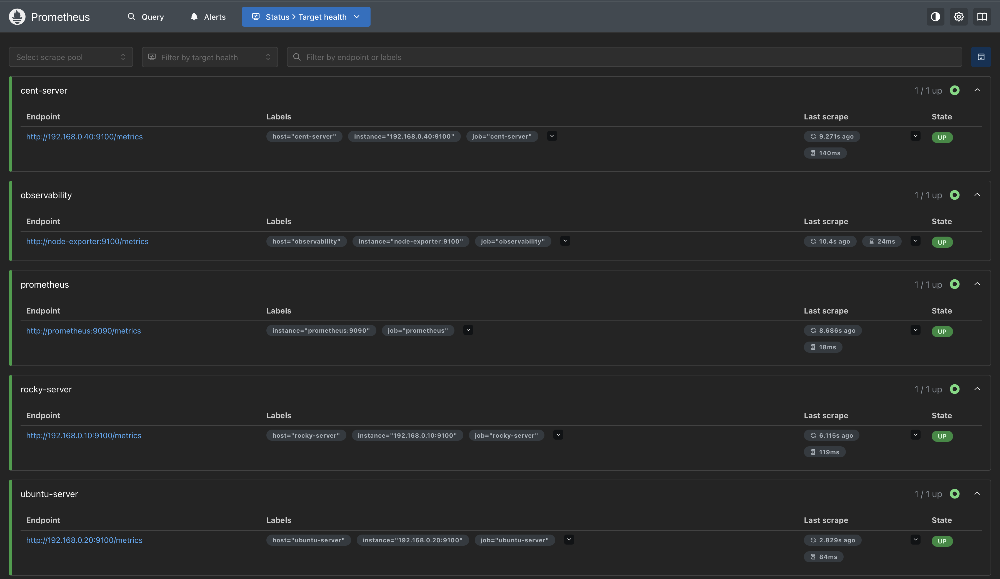
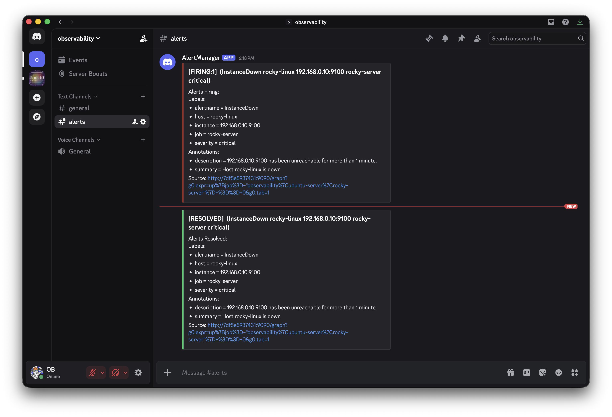
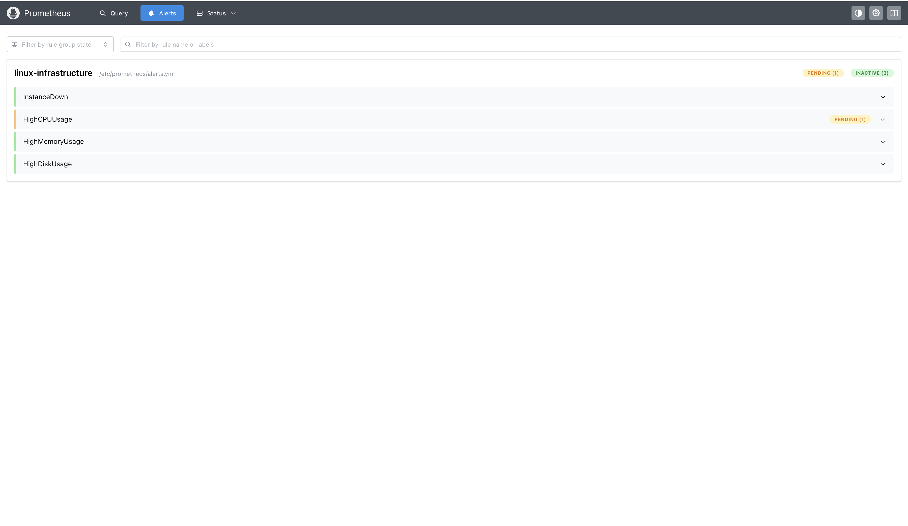

# Linux Observability Lab

A multi-host observability stack for Linux servers: **metrics** with Prometheus and Node Exporter, **logs** with Grafana Alloy and Loki, **dashboards** in Grafana, and **alerts** routed through Alertmanager to Discord.

The lab monitors a mixed fleet (Ubuntu, Rocky Linux, CentOS) from one central host, and was built to practise the monitor → detect → notify → investigate workflow used in Linux operations and cloud support roles. The central stack runs under Docker Compose, with Node Exporter and Alloy installed as systemd services on the monitored hosts.



## Stack

| Component | Image | Runs on | Purpose |
| --- | --- | --- | --- |
| Prometheus | `prom/prometheus:latest` | observability host | Scrapes metrics, stores time series, evaluates alert rules (port 9090) |
| Node Exporter | `prom/node-exporter:latest` (container) | observability host | Host metrics (port 9100) |
| Node Exporter | systemd service | monitored hosts | Host metrics (port 9100) |
| Loki | `grafana/loki:latest` | observability host | Centralized log storage, single binary with filesystem storage (port 3100) |
| Grafana Alloy | `grafana/alloy:latest` (container) | observability host | Reads the systemd journal and pushes it to Loki |
| Grafana Alloy | systemd service | monitored hosts | Reads the systemd journal and pushes it to Loki |
| Grafana | `grafana/grafana:latest` | observability host | Dashboards and log exploration (port 3000) |
| Alertmanager | `prom/alertmanager:latest` | observability host | Alert routing and Discord notifications (port 9093) |
| Docker Compose | n/a | observability host | Runs the central stack |

## Architecture



| Signal | Path |
| --- | --- |
| Metrics | Node Exporter → Prometheus (pull) → Grafana |
| Logs | journald → Alloy → Loki (push) → Grafana |
| Alerts | Prometheus rules → Alertmanager → Discord webhook |

## Monitored hosts

| Host name | Role | Address | Metrics via |
| --- | --- | --- | --- |
| `observability` | Runs the stack (Ubuntu Desktop) | `node-exporter:9100` (Compose network) | Node Exporter container |
| `ubuntu-server` | Monitored Ubuntu Server | 192.168.0.20 | Node Exporter systemd service, port 9100 |
| `rocky-server` | Monitored Rocky Linux server | 192.168.0.10 | Node Exporter systemd service, port 9100 |
| `cent-server` | Monitored CentOS server | 192.168.0.40 | Node Exporter systemd service, port 9100 |

Each target carries a `host` label in `prometheus/prometheus.yml`, which is what dashboards and alerts group by.

## Repository structure

```
linux-observability-lab/
├── README.md
├── docker-compose.yml
├── .gitignore
├── prometheus/
│   ├── prometheus.yml              # scrape jobs, Alertmanager target, rule file
│   └── alerts.yml                  # alert rules
├── alertmanager/
│   └── alertmanager.yml.template   # Discord receiver with webhook placeholder
├── loki/
│   └── loki-config.yml             # single-node Loki configuration
├── alloy/
│   └── config.alloy                # journald → Loki pipeline
└── docs/
    └── screenshots/
```

| File | Purpose |
| --- | --- |
| `docker-compose.yml` | Six services (Prometheus, Node Exporter, Grafana, Loki, Alertmanager, Alloy) with named volumes for their data |
| `prometheus/prometheus.yml` | 15-second scrape interval, static targets with `host` labels, the Alertmanager target, and the rule file |
| `prometheus/alerts.yml` | Four alert rules (see [Alerting](#alerting)) |
| `alertmanager/alertmanager.yml.template` | Discord receiver with `send_resolved: true` and a `${DISCORD_WEBHOOK_URL}` placeholder |
| `loki/loki-config.yml` | Filesystem storage, TSDB index with schema `v13`, in-memory ring, authentication disabled |
| `alloy/config.alloy` | Reads the journal and pushes to Loki with `job` and `host` labels |

## Logs

`alloy/config.alloy` defines a small pipeline:

1. `loki.source.journal` reads the systemd journal (mounted read-only from `/var/log/journal`), keeping entries up to 12 hours old.
2. Entries are labelled `job="journal"` and `host="<name>"`.
3. `loki.write` pushes them to `http://loki:3100/loki/api/v1/push`.

Example LogQL queries in Grafana Explore:

```logql
{job="journal"}
{job="journal", host="observability"}
{job="journal"} |= "error"
```

**Where Alloy runs.** On the observability host, Alloy is a container in the Compose stack, which is why this committed config hardcodes `host = "observability"` and talks to Loki at `loki:3100`. On each monitored host, Alloy and Node Exporter run as **systemd services** instead, so they start on boot and don't depend on Docker. Each remote Alloy uses the same pipeline with its own `host` label and pushes to the observability server's Loki endpoint on port 3100. The remote agent configs are not part of this repo.

| Observability server | Ubuntu Server |
| --- | --- |
|  |  |

## Alerting

Prometheus evaluates `prometheus/alerts.yml` and sends firing alerts to Alertmanager.

| Alert | Condition | `for:` | Severity |
| --- | --- | --- | --- |
| `InstanceDown` | `up == 0` for the observability, Ubuntu, Rocky, and CentOS targets | 1m | critical |
| `HighCPUUsage` | CPU usage above 80% (5m average) | 5m | warning |
| `HighMemoryUsage` | Memory usage above 85% (`MemAvailable`-based) | 5m | warning |
| `HighDiskUsage` | Root filesystem usage above 85% | 5m | warning |

Alerts move through **inactive → pending → firing**, so brief spikes never reach Discord. Alertmanager sends both firing and resolved notifications.

Only `scrape_interval` is set in `prometheus.yml`, so rules are evaluated at Prometheus's default one-minute interval, and Alertmanager's default grouping delay applies before the first notification. Expect a couple of minutes between a host going down and the Discord message.

| Pending | Firing |
| --- | --- |
|  |  |

## Requirements

- Docker and Docker Compose on the observability host
- `envsubst` (from the `gettext` package) to render the Alertmanager config
- Node Exporter and Grafana Alloy running on every monitored host, with port 9100 reachable from the observability host and Loki's port 3100 reachable from the monitored hosts
- A Discord webhook URL

## Secrets

The Discord webhook never enters Git:

- It is stored only in `.env`, which is git-ignored.
- `alertmanager/alertmanager.yml.template` holds only the `${DISCORD_WEBHOOK_URL}` placeholder.
- The generated `alertmanager/alertmanager.yml` is git-ignored.

Create `.env`:

```bash
DISCORD_WEBHOOK_URL=https://discord.com/api/webhooks/<id>/<token>
```

Alertmanager does not expand environment variables in its config file, so render it before starting the container:

```bash
set -a; source .env; set +a
envsubst < alertmanager/alertmanager.yml.template > alertmanager/alertmanager.yml
```

## Usage

```bash
git clone https://github.com/OB-Adams/linux-observability-lab.git
cd linux-observability-lab
```

1. Create `.env` and render `alertmanager/alertmanager.yml` as shown above.
2. Edit the static targets in `prometheus/prometheus.yml` to match your hosts.
3. Start the stack:

   ```bash
   docker compose up -d
   docker compose ps
   ```

4. In Grafana (port 3000), add two data sources using the Compose service names:

   | Data source | URL |
   | --- | --- |
   | Prometheus | `http://prometheus:9090` |
   | Loki | `http://loki:3100` |

| Service | Port |
| --- | --- |
| Grafana | 3000 |
| Prometheus | 9090 |
| Alertmanager | 9093 |
| Loki | 3100 |
| Node Exporter | 9100 |

## Verification

| Check | Command or URL |
| --- | --- |
| Containers running | `docker compose ps` |
| Prometheus targets | `http://<observability-host>:9090/targets`, every target should be UP |
| Alert rules loaded | `http://<observability-host>:9090/alerts` |
| Alertmanager | `http://<observability-host>:9093` |
| Loki ready | `curl http://<observability-host>:3100/ready` |
| Logs in Grafana (Explore, Loki) | `{job="journal", host="observability"}` |
| Grafana data sources | Save and test both data sources in Grafana |
| Test the alert | `sudo systemctl stop node_exporter` on a monitored host, wait a couple of minutes, and check Discord |

## Dashboards and metrics

Prometheus scrapes every target every **15 seconds**. The dashboard covers CPU, memory, disk, load, network traffic, and host availability.





## Notification path

Alertmanager delivers notifications to Discord:



The same pipeline carries the resource alerts, such as `HighCPUUsage` while it is pending:



## Design notes and limitations

This is a lab project, and some choices reflect that:

- **Images use the `latest` tag**, so rebuilding the stack can pull different versions over time.
- **Loki has `auth_enabled: false`** and no service is behind TLS, which is acceptable for an isolated lab network.
- **No explicit retention.** Prometheus and Loki use their defaults and no retention is configured.
- **Alertmanager routing is minimal.** The route has a single receiver, so grouping and repeat timing use Alertmanager's defaults and there is no routing by severity.
- **Static targets.** Hosts are listed by hand in `prometheus.yml`, and rules are evaluated at the default one-minute interval.
- **Grafana is configured in the UI.** The two data sources and the dashboard are created by hand and are not provisioned from files in this repository.
- **Remote agents are outside the repo.** The Node Exporter and Alloy configs for the monitored hosts are not included, and the central host's Alloy label is hardcoded.
- **Metrics-based alerts only.** There are no log-based alerts.

## What I learned

- Pull-based metrics and push-based logs solve different problems and complement each other
- Alert quality matters as much as coverage: thresholds, `for:` windows, and severity labels keep alerts actionable
- Running Ubuntu, Rocky, and CentOS together exposes real differences in firewalls, SELinux, and package management
- Alloy replaces Promtail with a more flexible pipeline model, and journald is a cleaner log source than tailing files
- Secrets handling has to be designed in from the start

## Related project

[ansible-observability-lab](https://github.com/OB-Adams/ansible-observability-lab) is a separate project that deploys a similar stack with Ansible: native systemd services across Ubuntu, Rocky Linux, and CentOS, with verified downloads and validated configuration. This repository focuses on the monitoring side instead: alert design, the Grafana dashboard, the Alloy log pipeline, and a containerized deployment. The two use the same tools but are built and configured independently.

## Author

**Ebenezer Obiri Adams** ([@OB-Adams](https://github.com/OB-Adams))
